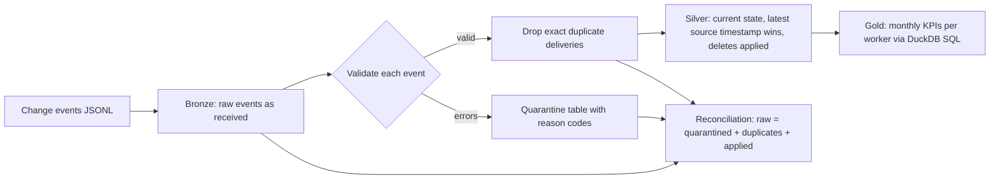

# cdc-quality-pipeline: CDC Ingestion with Data-Quality Gates

[](https://github.com/poojabhather99/cdc-quality-pipeline/actions/workflows/ci.yml)


A small, fully reproducible demo of how to turn a messy change-data-capture (CDC) stream into trustworthy analytics. It ingests Debezium-style change events, validates every record, quarantines bad ones with reasons, applies the rest in source-timestamp order, and publishes monthly KPIs, with a reconciliation check proving that **no event is silently lost**.

All data is synthetic and generated by the project; the domain (community visit records) is only a realistic example.

## Pipeline



| Layer | What it holds | Why |
|---|---|---|
| Bronze | Every event exactly as received, with arrival order | Replayable source of truth |
| Quarantine | Rejected events plus comma-separated reason codes | Bad data is visible and fixable, not dropped |
| Silver | One current row per visit | Ordered by **source timestamp**, so late or out-of-order events still land correctly |
| Gold | Visits, completions, completion rate, average duration per worker per month | Ready for dashboards |

## Problems the generator injects (and the pipeline handles)

- **Out-of-order arrival:** events are shuffled, so an update can arrive before its create.
- **Duplicate deliveries:** at-least-once delivery sends some events twice.
- **Deletes:** a delete followed by a late create must not resurrect the row.
- **Schema drift:** extra columns appear on some events and are tolerated.
- **Corrupted records:** null keys, impossible dates, negative durations, unknown statuses, malformed IDs.

## Quality rules

Required fields present, worker ID format (`W###`), allowed status and visit type, parseable date that is not in the future, duration numeric and between 0 and 480 minutes, valid operation and timestamp on the event itself, and a key on every delete. Rule code lives in `src/cdcpipe/quality.py`, one function, one error code per failure.

## Example run

`python -m cdcpipe.run` on the default seed (300 visits):

| Metric | Count |
|---|---|
| Raw events | 544 |
| Quarantined | 13 |
| Duplicates dropped | 20 |
| Events applied | 511 |
| Visits deleted | 29 |
| Live visits in silver | 265 |
| Gold rows (worker x month) | 125 |

Quarantine reasons: `bad_date` 5, `bad_status` 3, `missing_worker_id` 3, `duration_out_of_range` 1, `bad_worker_format` 1.

The run fails loudly if the books do not balance: `quarantined + duplicates_dropped + events_applied` must equal `raw_events`.

## Gold KPI definition

Completion rate is `completed / (completed + missed)`. Visits still `scheduled` are excluded from the denominator so that an unfinished month does not look like poor performance. Average duration is over completed visits only. The SQL is in `src/cdcpipe/layers.py` and is checked against a hand-computed fixture in the tests.

## Run it

```bash
git clone https://github.com/poojabhather99/cdc-quality-pipeline.git
cd cdc-quality-pipeline
python -m venv .venv && source .venv/bin/activate
pip install -r requirements-dev.txt
export PYTHONPATH=src

python -m pytest                    # 20 tests
python -m cdcpipe.run               # writes data/raw, data/silver, data/gold
python -m cdcpipe.run --visits 2000 --seed 42
```

## Project structure

```
src/cdcpipe/generate.py   synthetic Debezium-style event generator
src/cdcpipe/quality.py    validation rules and error codes
src/cdcpipe/layers.py     bronze loader, silver builder (dedupe, ordering, deletes), gold SQL
src/cdcpipe/run.py        CLI and reconciliation check
tests/test_pipeline.py    rules, ordering, deletes, duplicates, schema drift, KPIs, reconciliation
```

## Design notes and limits

- This is a single-machine demo with pandas and DuckDB. The same logic maps onto a streaming job plus a warehouse: validation as a pre-write gate, quarantine as a dead-letter table, silver as a merge keyed on `visit_id`.
- Duplicates are detected by exact match on key, operation, timestamp and payload. Events that differ only in timestamp are treated as separate changes.
- Next steps: incremental processing (watermarks) instead of full reloads, per-rule quality metrics over time, and alerting when the quarantine rate crosses a threshold.

## License

MIT
